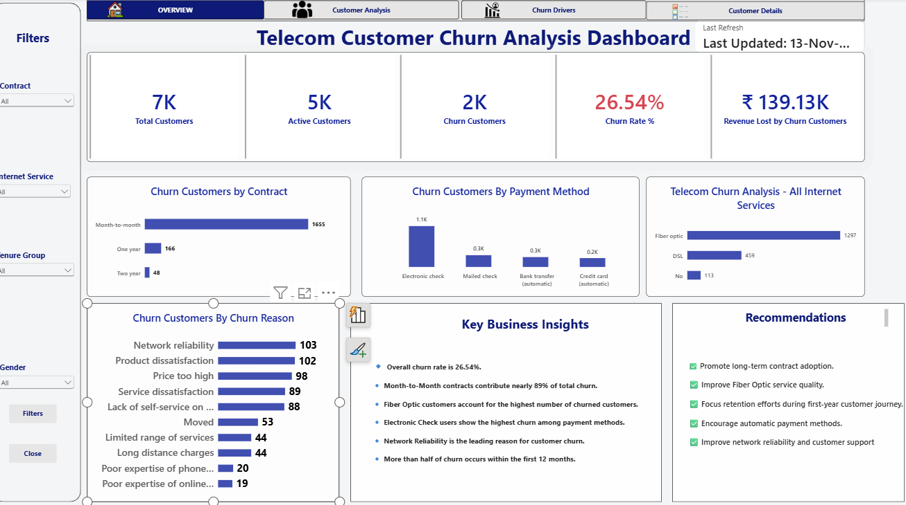

# Telecom Customer Churn Analysis

## Objective
Identify why telecom customers leave and flag high-risk segments
so the business can take action to retain them.

## Tools Used
Python (Pandas, NumPy), SQL, Power BI, DAX

## Dataset
[Name of dataset, e.g. Telco Customer Churn], [number] records,
[number] columns covering contract type, tenure, services and billing.

## Approach
1. **Data cleaning (Python):** handled missing values, fixed data types, removed duplicates
2. **Analysis (Python + SQL):** explored churn by contract type, tenure, services and billing
3. **Dashboard (Power BI):** built views of churn by segment with DAX measures

## Key Findings
- [Finding 1, e.g. Month-to-month customers churn the most: X%]
- [Finding 2, e.g. Customers with tenure under 12 months are highest risk]
- [Finding 3, e.g. Higher monthly charges are linked to higher churn]

## Dashboard Preview

## Project Structure
- `data/` - raw dataset
- `code/` - Python notebook and SQL queries
- `dashboard/` - Power BI file and screenshots
- `presentation/` - project presentation

## Author
Yamini Sudulaguntla
[https://www.linkedin.com/in/yamini-sudulaguntla] | yaminisudulaguntla@gmail.com
